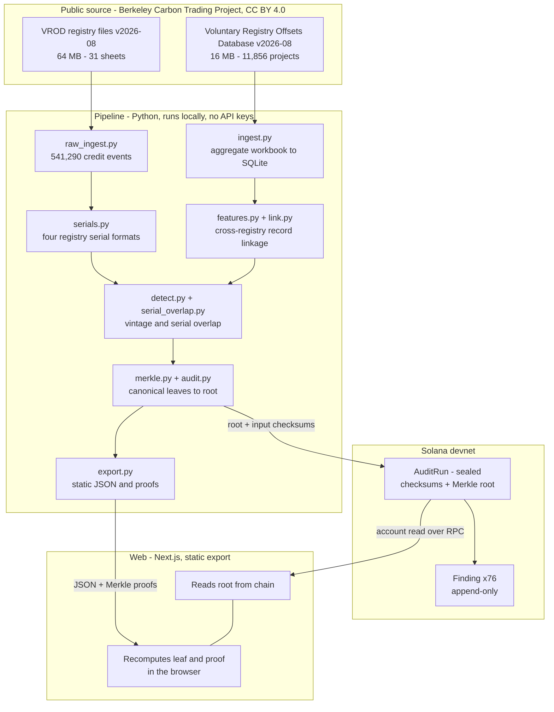

# Tally

**Cross-registry detection of double-counted carbon credits, attested on
Solana.**

Live site: https://tally-henna-nine.vercel.app/
Attestation: [`FBG6tQ5BVzK4jg3VEiHNSawZDvmdsLJG712tuWEDcuJH`](https://explorer.solana.com/address/FBG6tQ5BVzK4jg3VEiHNSawZDvmdsLJG712tuWEDcuJH?cluster=devnet)
(Solana devnet, sealed)

---
https://www.youtube.com/watch?v=Eb5kjpv5Y3I
## The problem

A carbon credit represents one tonne of CO2 that was not emitted, or was
removed from the atmosphere. Whoever buys it uses it to offset their own
emissions. The rule the entire market depends on is that each tonne is
counted once.

Six registries issue credits independently — Verra, Gold Standard,
American Carbon Registry, Climate Action Reserve, ART and Isometric. Each
keeps its own database, in its own format, with no link to the others.
None can see what the others issued.

So one physical project can register with two of them and earn credits in
both for the same reduction. No public tool cross-checks this.

## What Tally found

Reading 11,856 projects and 541,290 credit-level events from the public
record:

| | |
| --- | --- |
| **361,903 credits** | evidenced as counted more than once |
| 13 projects | credited for the same vintage year by two registries |
| 1 project | whose own serial ranges were retired three times over |
| 56 projects | cross-listed but **cleared** — legitimate registry moves |
| 6 cases | the same transaction exported twice; a data quality note, not double counting |
| 8 pairs | awaiting human review, deliberately excluded from the result |

The largest finding: **Kielty Abandoned Mine Methane Recovery**. The ACR
issued 266,038 credits and the CAR issued 147,508, and vintage 2025
appears in full on both sides. The CAR side has already been retired by a
buyer; the ACR side is still available for sale.

Each finding is classified by what became of both copies — both still
available, one already claimed, or both claimed by different buyers. That
distinction is what makes the number mean something: "credits are
duplicated" has no consequence attached, "two companies offset their
emissions with the same tonne" does.

## Why it is on a blockchain

The parties whose records are being audited are the registries. Storing
audit results in a database that one operator controls would ask readers
to trust exactly the kind of party the tool exists to check.

The result is committed to an append-only Solana account. Both input
checksums are recorded before the result, findings must arrive in order,
and the run is sealed only once complete — after which nothing can be
added, changed or removed.

On the site, pressing **Run the check** makes your browser read the
account from Solana, rebuild the finding's fingerprint from the fields
displayed on the page, walk the Merkle proof to the root, and compare.
The verification is a second, independent implementation of the hashing
in TypeScript: if it disagreed with the Python pipeline, it would fail
visibly rather than quietly agree with itself.

## Architecture



Both input checksums are written to the chain **before** the result, so
the attestation commits to the inputs as well as the output. The browser
reads the root from Solana rather than from this project's own JSON: a
page that checked itself would prove nothing.

## How the detection works

**Candidate generation.** 977,904 cross-registry pairs are compared,
blocked by country. Country blocking is not only an optimisation: it is
what stops an Indian wind farm matching a Chinese one.

**Rejection by evidence.** A field populated on both sides that disagrees
rejects the pair outright; an empty field never rejects, because absence
is not evidence. 63 pairs were rejected for conflicting identity markers,
8 for having no distinctive vocabulary left once sector words were
removed, 4 for conflicting states, 2 for conflicting project types.

Identity markers are derived from the corpus rather than hand-written. A
token appearing in under 1% of projects identifies; above that it
describes. A token occurring in exactly one country is a place name at
any frequency — which is what separates a Gujarat wind project from a
Karnataka one when every other word in both names is identical.

**Confirmation.** A name match alone is never a finding. Two registries
must have issued credits for the *same vintage year* — the year the
reduction physically occurred. 69 projects issue in two registries; only
13 share a vintage. The other 56 moved registries cleanly and are
published as cleared.

## Reproducing the result

```bash
python3 -m venv .venv
./.venv/bin/pip install pandas openpyxl scikit-learn rapidfuzz pytest

# Download both workbooks into data/raw/ from
# https://gspp.berkeley.edu/berkeley-carbon-trading-project/offsets-database
# and confirm their checksums against DATA_SOURCE.md

./.venv/bin/python -m pytest tests/ -q      # 96 tests
./.venv/bin/python scripts/run_audit.py     # prints the Merkle root
```

The root printed must equal the one in the sealed account.

The on-chain program builds and tests separately:

```bash
cd onchain && anchor build && cargo test --manifest-path programs/onchain/Cargo.toml
```

## Repository layout

| Path | Contents |
| --- | --- |
| `src/tally/` | Analysis pipeline |
| `tests/` | 96 tests, including every published figure |
| `onchain/` | Anchor program, 8 tests |
| `web/` | Next.js site, static export |
| `scripts/` | Pipeline entry points and the inspection scripts used during development |
| `SECURITY.md` | Threat model, and three errors this project made and corrected |
| `DATA_SOURCE.md` | Source attribution, checksums, attestation addresses |

## What Tally does not claim

Tally reports what the public data contains. A flagged pair is a case
requiring explanation, not a finding of wrongdoing — several will have
legitimate explanations the public record does not contain.

Known limits are documented in `SECURITY.md`. The most important: linkage
works from names and surrounding fields, so where two registries describe
the same project very differently, Tally misses it. 13 is a floor, not a
total.

## Licence and attribution

Data: Voluntary Registry Offsets Database v2026-08, Berkeley Carbon
Trading Project, University of California, Berkeley. CC BY 4.0. Full
citation in `DATA_SOURCE.md`. The Berkeley Carbon Trading Project is the
source of the data and is not connected to this analysis.

Built for the IEEE ClimateChain Global Hackathon 2026, track 1: Carbon
Markets & Emissions Transparency.
